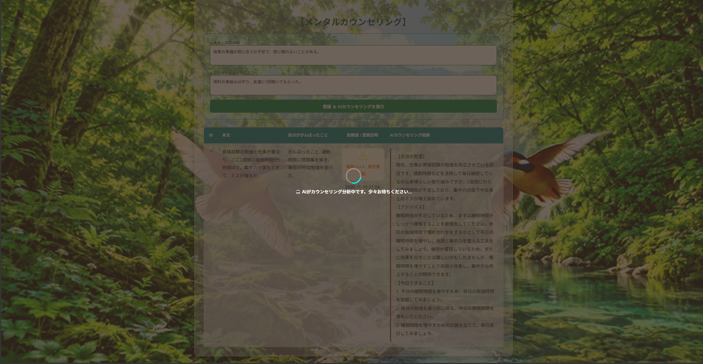
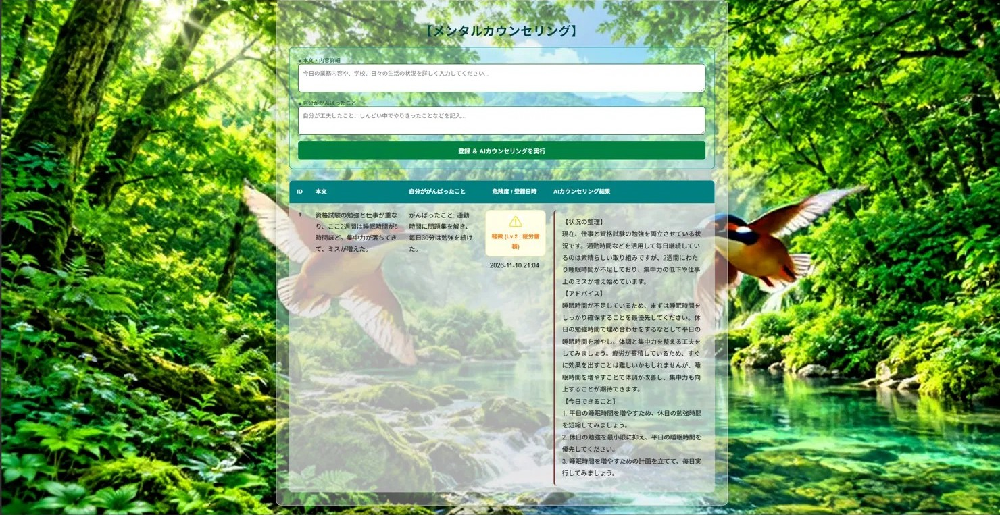

# mental-counseling(メンタルカウンセリングWebアプリ)

悩みと「がんばったこと」を入力すると、3つのAIが連携して
**メンタルの危険度の判定**と**相談者のメンタルカウンセリング**をし、少しでも生活・職場・学校などで前向きになるきっかけを作ることを目的としたWebアプリです。


## デモ

- デモ動画:https://youtu.be/GV0grZC4axk

### 分析中の画面


### 実行結果の画面



## 主な機能
- 相談内容と「がんばったこと」の入力・保存
- 5段階の危険度判定(Lv.1 軽度ストレス 〜 Lv.5 危険)
- AIによるカウンセリング結果の作成(状況の整理 / アドバイス / 今日できること)
- 危険度に応じたバッジ表示

## 使用技術

- Java 21 / Spring Boot 4.1 / Spring Data JPA / Thymeleaf
- H2 Database(開発用)、MySQLドライバ導入済み
- Gemini API / Groq API / Cloudflare Workers AI
- Gradle

## 工夫した点:3つのAIのフォールバック設計

```
入力
 ↓
① Gemini(APIキー3個を順番に試す)で分析
 ↓ 失敗した場合
② Groq で分析
 ↓
③ Cloudflare がカウンセリング結果の文章を作成
 ↓
データベースに保存して一覧表示
```

- 無料枠の制限や通信エラーで1つのAIが失敗しても、処理全体を止めない設計にしました。
- 各段階の成功・失敗・スキップをログに出力し、どこで失敗したか追跡できます。
- AIの返す危険度は、指定した5段階以外を受け付けないように検証しています。
- `CounselingService` が3つのAIサービスの呼び出し順と切り替えを制御し、画面側(Controller)は
  AIの切り替えを意識しなくてよい作りです。
- APIキーはコードに書かず、環境変数から読み込みます。

## 構成

```
src/main/java/com/example/survivorslog
├── LogController.java            画面とのやり取り
├── CounselingService.java        3つのAIの呼び出し順と切り替えの制御
├── GeminiAnalysisService.java    AI① 分析
├── GroqFallbackService.java      AI② 分析(代替)
├── CloudflareReportService.java  AI③ カウンセリング結果の作成
├── AiAnalysisResult.java         分析結果を保持するクラス
├── Log.java                      データベースのテーブル定義
└── LogRepository.java            データベース操作
```

## 起動方法

1. 環境変数を設定します。

   | 変数名 | 内容 |
   |---|---|
   | `GEMINI_API_KEY` | Gemini APIキー(`_2`、`_3`は予備) |
   | `GROQ_API_KEY` | Groq APIキー |
   | `CLOUDFLARE_ACCOUNT_ID` | CloudflareのアカウントID |
   | `CLOUDFLARE_API_TOKEN` | CloudflareのAPIトークン |

2. 次のコマンドで起動します。

   ```
   ./gradlew bootRun
   ```
   (Windowsは `gradlew.bat bootRun`)

3. ブラウザで http://localhost:8081 を開きます。

※ 背景動画は容量の都合でリポジトリに含めていません。動画がなくても動作します。

## 今後の課題

- ユーザー認証の追加(現在は全員の記録が一覧に表示されるため、公開運用には向きません)
- 記録を本人にだけ表示する仕組み
- MySQLなど永続的なデータベースへの切り替え(現在のH2はメモリ上のため、再起動で記録が消えます)
- 送信回数の制限(APIの無料枠を守るため)
- テストコードの充実

## 注意

本アプリは医療行為ではなく、AIによる診断を行うものではありません。
